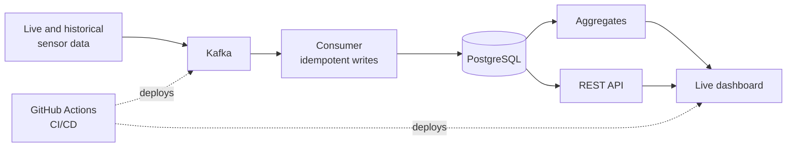

<h1 align="center">Vaibhav Alluri</h1>

  <b>Data Engineer</b> · Kafka · Python · PostgreSQL · Azure &amp; AWS · Ex-Amazon

  
  
  

  I build data pipelines that keep working when things fail: replay-safe, recoverable, and deployed end to end.

### Featured projects

| Project | What it shows |
|---|---|
| **[Real-Time Telemetry Analytics Platform](https://github.com/alluriv2/real-time-telemetry-analytics-platform)** Kafka · PostgreSQL · FastAPI · Dash · AWS | End-to-end: ingestion, storage, API, live dashboard. 1,000-record batches, Kafka offsets committed after the database commit, auto-deploy once CI passes |
| **[Enterprise Analytical Data Warehouse](https://github.com/alluriv2/enterprise-analytical-data-warehouse)** SQL · MySQL | Sales and rental sources in one star schema, late-arriving fact handling, SCD Type 2 history |
| **[Weather Analytics on Kubernetes](https://github.com/alluriv2/Weather-Analytics-Platform)** Kafka · Kubernetes · Prometheus · Grafana | Same design on Kubernetes: ordered startup, per-station watermarks, scheduled reconciliation |
| **[911CallSight](https://github.com/alluriv2/911CallSight)** Whisper · Ollama · PostgreSQL · Flask | Audio to structured, queryable incident data with a local LLM |
| **[Weather Data Ingestion Pipeline](https://github.com/alluriv2/weather-data-ingestion-pipeline)** Python · DuckDB | Incremental, idempotent ingestion of live station logs |
| **[YourFlix](https://github.com/alluriv2/YourFlix)** Swift · SwiftUI | Native macOS app that turns photo folders into a streaming-style library |

Also built: a Java and Spring Boot version of the weather platform (600K+ observations per station, zero data loss across restarts) and a counterfactual analysis of EMS stroke response times on the 2024 NEMSIS dataset.

### Experience

| | |
|---|---|
| **Now** | Data Engineer, Global Infrastructure Services: private-networked Azure environment (AKS, HDInsight Kafka, SQL Server) for a public-health data platform, with runbooks and readiness criteria for its move to pilot |
| **Before** | Amazon, Data Analyst and Business Analyst: complaint analysis behind a 45% drop in complaint rates; appeal analysis that lifted a compliance classifier from 46% to 65% accuracy |
| **Education** | MS Applied Data Science, Clarkson University (4.0 GPA) |

### Tools

  

