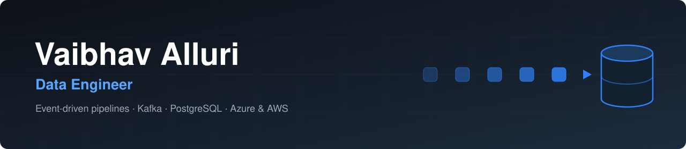

  

## Hey, I’m Vaibhav 👋

I’m a data engineer based in New Jersey. I enjoy connecting pipelines, infrastructure, storage, and backend services into platforms that remain dependable as they grow.

This is where I keep the things I’m building, experimenting with, and learning along the way.

- 🔭 Building cloud infrastructure for a public-health data platform
- ⚙️ Working with batch pipelines, event streams, and backend services
- 🌱 Exploring Java, Spring Boot, and Databricks
- 📝 Sharing the deeper engineering stories at [alluriv.dev](https://alluriv.dev)

## 🧰 Tools I Reach For

  

  Python · Java · SQL · Kafka · PostgreSQL · Azure · Kubernetes · Terraform

## 🎓 Certifications

**Databricks Certified Data Engineer Associate**  
Databricks · Issued October 2026 · Expires October 2028

## 🤝 Say Hello

Always happy to connect and chat about data platforms, distributed systems, or a bug that refuses to explain itself.

  
  &nbsp;&nbsp;
  
  &nbsp;&nbsp;
  

