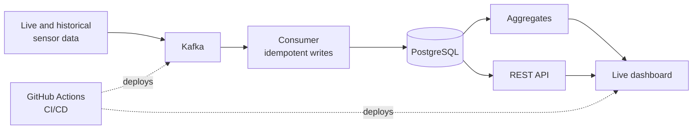

<h1 align="center">Vaibhav Alluri</h1>

  <b>Data Engineer</b> · Kafka · Python · PostgreSQL · Azure &amp; AWS · Ex-Amazon

  
  
  

  I build data pipelines that keep working when things fail: replay-safe, recoverable, and deployed end to end.

### Experience

| | |
|---|---|
| **Now** | Data Engineer, Global Infrastructure Services: private-networked Azure environment (AKS, HDInsight Kafka, SQL Server) for a public-health data platform, with runbooks and readiness criteria for its move to pilot |
| **Before** | Amazon, Data Analyst and Business Analyst: complaint analysis behind a 45% drop in complaint rates; appeal analysis that lifted a compliance classifier from 46% to 65% accuracy |
| **Education** | MS Applied Data Science, Clarkson University (4.0 GPA) |

### Tools

  

